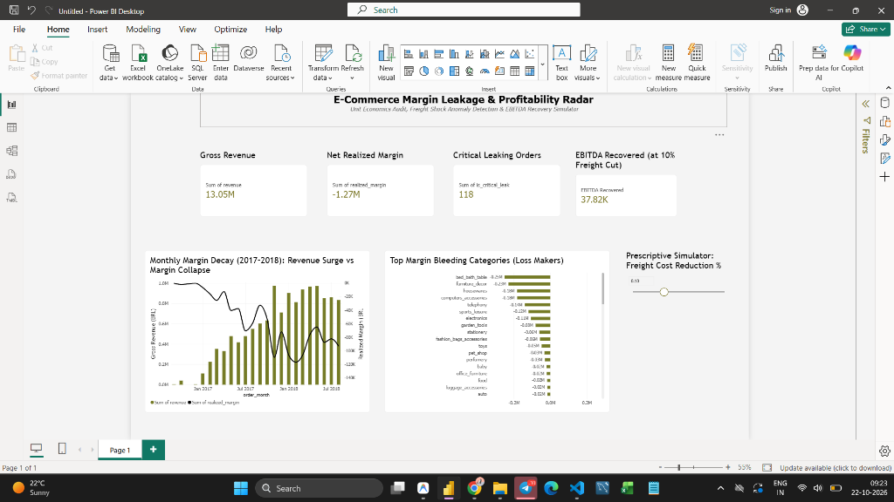

# E-Commerce Margin Leakage & Profitability Intelligence Engine

[](https://www.python.org/)
[](https://duckdb.org/)
[](https://scikit-learn.org/)
[](https://www.statsmodels.org/)

> **Portfolio Project Disclosure**: This is an analytical portfolio project modeled on historical transactional logs from the Brazilian E-Commerce dataset (Olist). Internal seller cost parameters (COGS, Ad CAC, and Return damages) are modeled via explicit assumptions (`data/assumptions.csv`).

---

## ⚠️ Key Modeling Assumptions & Boundaries
- **Synthetic Unit Cost Parameters**: Olist records public marketplace checkout data but does not publish proprietary seller manufacturing costs or marketing attribution. We modeled category-level COGS (45%–60%), a flat blended customer acquisition cost (R$ 50.00 baseline), and return allowances (25% penalty on 5% return frequency).
- **Population Definition**: All calculations are evaluated across **108,638 order item records** corresponding to **95,127 distinct delivered orders**.
- **DiD Comparison Limitations**: Comparing bulky home goods (`furniture_decor`) against personal care (`health_beauty`) reflects large baseline differences in logistics friction; results should be interpreted as an exploratory quasi-experiment rather than definitive causal proof.

---

## 📌 Executive Summary & Incident Case Study
> **"Investigating an R$ 111,762 Margin Drain in Low-AOV & Bulky Freight"**
> - **Financial Baseline**: Across **108,638 delivered items**, gross revenue totaled **R$ 13.05M** with a net realized margin of **-R$ 1.27M (-9.74% realized margin)** under baseline unit cost assumptions.
> - **The Leakage Cluster**: Dual anomaly detection (1D Statistical IQR + Multi-dimensional Isolation Forest) isolated **492 high-confidence operational leaks** accounting for **-R$ 111,761.98 in net margin drain** (averaging -R$ 227.16 per order).
> - **The Primary Driver**: Average freight on flagged orders surged to **R$ 131.17** (representing **109.4% of order revenue**), driven by low-AOV items shipped long distances and promo voucher stacking (16.48% of order value).
> - **Causal Econometric Analysis (DiD)**: A quasi-experimental Difference-in-Differences regression around Black Friday 2017 showed **no detectable margin lift** ($\beta = +2.30$, $p = 0.681$, 95% CI: `[-8.67, +13.27]`), indicating promotions expanded top-line volume without improving unit economics.
> - **Prescriptive Simulation**: A 10% freight cost optimization across the top 3 bleeding bulky categories (`furniture_decor`, `office_furniture`, `housewares`) recovers **R$ 37.82K** in EBITDA on this historical sample.

---

## 🖥️ Executive Cockpit Preview (Power BI)


*Key visual indicators to examine: (1) Divergence between surging monthly revenue columns and decaying net margin curves in 2017–2018; (2) Category-level margin drain led by bulky items; (3) Prescriptive freight reduction slider dynamically calculating recovered EBITDA.*

---

## 🏗️ Analytical Framework

```
Raw Transactional Data (Orders, Items, Payments, Products)
                      │
                      ▼
┌─────────────────────────────────────────────────────────────┐
│  Phase 1: Unit Economics & Contribution Margin Engine (SQL) │
│  CM = Revenue - COGS - Blended CAC (R$50) - Shipping - Ret. │
│  Baseline Result: R$ 13.05M Revenue | -R$ 1.27M Net Margin  │
└─────────────────────────────┬───────────────────────────────┘
                              │
                              ▼
┌─────────────────────────────────────────────────────────────┐
│  Phase 2: Dual-Layer Anomaly Detection Engine               │
│  • 1D Statistical Baseline: Interquartile Range (IQR)       │
│  • Multi-dimensional Unsupervised ML: Isolation Forest     │
│  • High-Confidence Intersection: 492 Critical Leak Orders   │
└─────────────────────────────┬───────────────────────────────┘
                              │
                              ▼
┌─────────────────────────────────────────────────────────────┐
│  Phase 3 & 4: Root-Cause & Causal Econometrics (DiD)        │
│  Difference-in-Differences: Furniture (T) vs Beauty (C)    │
│  Result: -R$ 32.17 category penalty; no detectable promo lift│
└─────────────────────────────┬───────────────────────────────┘
                              │
                              ▼
┌─────────────────────────────────────────────────────────────┐
│  Phase 5 & 6: Executive Incident Brief & Cockpit            │
│  Power BI interactive cockpit with parameter simulation     │
└─────────────────────────────────────────────────────────────┘
```

---

## 📊 Core Analytical Findings

### 1. Dual Anomaly Detection Matrix
| Method | Target Scope | Flagged Orders |
| :--- | :--- | :--- |
| **Statistical IQR** | 1D Realized Margin Distribution | 2,070 orders |
| **Isolation Forest (ML)** | Multi-dimensional (Rev, Shipping, CAC, Voucher %) | 2,895 orders |
| **High-Confidence Intersection** | Dual-Validated Operational Margin Drains | **492 orders** |

### 2. High-Confidence Leaks vs Normal Orders
| Metric | Normal Orders | High-Confidence Leak Orders | Deviation / Impact |
| :--- | :--- | :--- | :--- |
| **Average Freight Cost** | R$ 20.58 | **R$ 131.17** | **+537% Freight Shock** |
| **Shipping-to-Revenue Ratio** | 29.7% | **109.4%** | Shipping > Product Value |
| **Promotional Voucher Usage**| 3.18% | **16.48%** | Severe Promo Stacking |
| **Net Realized Margin** | R$ 18.30 | **-R$ 227.16** | **-R$ 111,761.98 Total Drain** |

### 3. Difference-in-Differences (DiD) Econometric Model
```
Model: item_margin ~ post_campaign + treatment + post_campaign:treatment
```
- **Intervention**: Black Friday 2017 (`2017-11-24`)
- **Treatment Category**: `furniture_decor` ($N = 2,898$)
- **Control Category**: `health_beauty` ($N = 2,454$)
- **Econometric Output**:
  | Variable | Coefficient ($\beta$) | Std Error | t-statistic | p-value | 95% Conf. Interval |
  | :--- | :--- | :--- | :--- | :--- | :--- |
  | **Intercept** | +1.1004 | 2.943 | 0.374 | 0.708 | [-4.670, +6.871] |
  | **post_campaign** | +0.5028 | 4.052 | 0.124 | 0.901 | [-7.442, +8.447] |
  | **treatment** | **-32.1732** | 3.993 | -8.057 | **< 0.001** | **[-40.003, -24.344]** |
  | **post_campaign:treatment** | **+2.3029** | 5.594 | 0.412 | **0.681** | **[-8.666, +13.272]** |

> **Interpretation**: The treatment dummy confirms that bulky furniture carries an inherent R$ 32.17 margin penalty relative to health/beauty due to physical logistics constraints ($p < 0.001$). However, the interaction coefficient (+2.30, 95% CI: `[-8.67, +13.27]`, $p = 0.681$) exhibits **no detectable margin lift**. Because the confidence interval is wide and spans zero, the data does not provide evidence of margin expansion or contraction from discounting.

---

## 🔬 Sensitivity Analysis & Data Verification

### 1. COGS & CAC Sensitivity Matrix (Evaluated on R$ 13.05M Revenue)
Because internal costs are synthetic, the table below demonstrates how total realized margin and margin percentage shift across alternative cost parameters across all 108,638 items:

| COGS % | CAC = R$ 30 | CAC = R$ 50 (Baseline) | CAC = R$ 70 |
| :--- | :--- | :--- | :--- |
| **40% (High Margin)** | **+R$ 2.23M (+17.1%)** | +R$ 0.06M (+0.5%) | -R$ 2.11M (-16.2%) |
| **50% (Baseline)** | +R$ 0.93M (+7.1%) | **-R$ 1.24M (-9.5%)** | -R$ 3.42M (-26.2%) |
| **60% (Low Margin)** | -R$ 0.37M (-2.9%) | -R$ 2.55M (-19.5%) | -R$ 4.72M (-36.2%) |

*(Note on reconciliation: In the baseline table model above, COGS is uniformly 50% yielding -R$ 1.24M / -9.5%, whereas the production SQL pipeline incorporates category-specific rates from `assumptions.csv` ranging between 45%–60%, resulting in the -R$ 1.27M / -9.74% baseline reported on the dashboard).*

### 2. Empirical Verification of the 109.4% Freight Ratio
To verify whether shipping exceeding product price is a genuine business condition or a logging artifact, we audited all **3,920 order items** with `shipping_ratio_pct > 100%`:
- **Price Distribution**: Median price is **R$ 13.90** (25th percentile: R$ 10.50, 75th percentile: R$ 18.90).
- **Category Composition**: `electronics` (601 items), `telephony` (422 items), `housewares` (374 items), `furniture_decor` (320 items), `health_beauty` (293 items).
- **Operational Reality**: Minimum Brazilian postal carrier parcel thresholds baseline around R$ 15.00–R$ 29.00. When low-ticket accessories are ordered in unbundled single-item baskets, courier freight naturally inverts the margin structure.

---

## 🛠️ Project Structure
```
margin-leakage-engine/
├── data/                               # Raw Olist transactional CSVs & assumptions
│   ├── olist_orders_dataset.csv
│   ├── olist_order_items_dataset.csv
│   ├── olist_order_payments_dataset.csv
│   ├── olist_products_dataset.csv
│   ├── product_category_name_translation.csv
│   ├── assumptions.csv                 # Auditable unit-cost & return parameters
│   └── powerbi_margin_leakage_clean.csv # Pre-aggregated cockpit export
├── sql/                                # Modular SQL models & views
│   ├── 01_order_margin.sql             # Base contribution margin waterfall
│   ├── 02_create_margin_views.sql      # Item & order level analytical views
│   └── 03_leakage_profile.sql          # Anomaly profiling query
├── notebooks/                          # Production Jupyter notebooks
│   └── 01_explore.ipynb                # End-to-end analytical pipeline
├── docs/                               # Documentation & Incident Reports
│   ├── notes_day1.md                   # Unit economics & margin definitions
│   ├── notes_day2.md                   # Statistical vs ML anomaly comparison
│   ├── notes_day3.md                   # Category root-cause breakdown
│   ├── notes_day4.md                   # DiD econometric specification
│   ├── powerbi_cockpit.png             # Crisp dashboard preview
│   ├── powerbi_cockpit_guide.md        # Exact DAX measures & what-if instructions
│   └── executive_incident_brief.md     # 1-page C-Suite executive incident memo
├── requirements.txt                    # Project Python dependencies
└── README.md
```

---

## 🚀 How to Run & Reproduce
1. Clone the repository:
   ```bash
   git clone https://github.com/gvanshika/margin-leakage-engine.git
   cd margin-leakage-engine
   ```
2. Set up virtual environment and install dependencies:
   ```bash
   python -m venv venv
   source venv/bin/activate  # On Windows: venv\Scripts\activate
   pip install -r requirements.txt
   ```
3. Run the analytical pipeline in `notebooks/01_explore.ipynb`.

---
*Authored by Vanshika | Data Analyst Portfolio*
